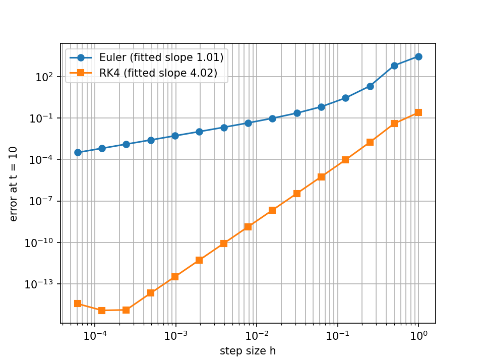
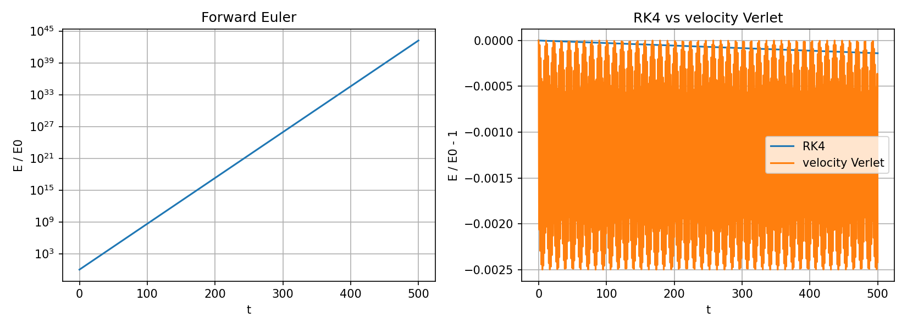
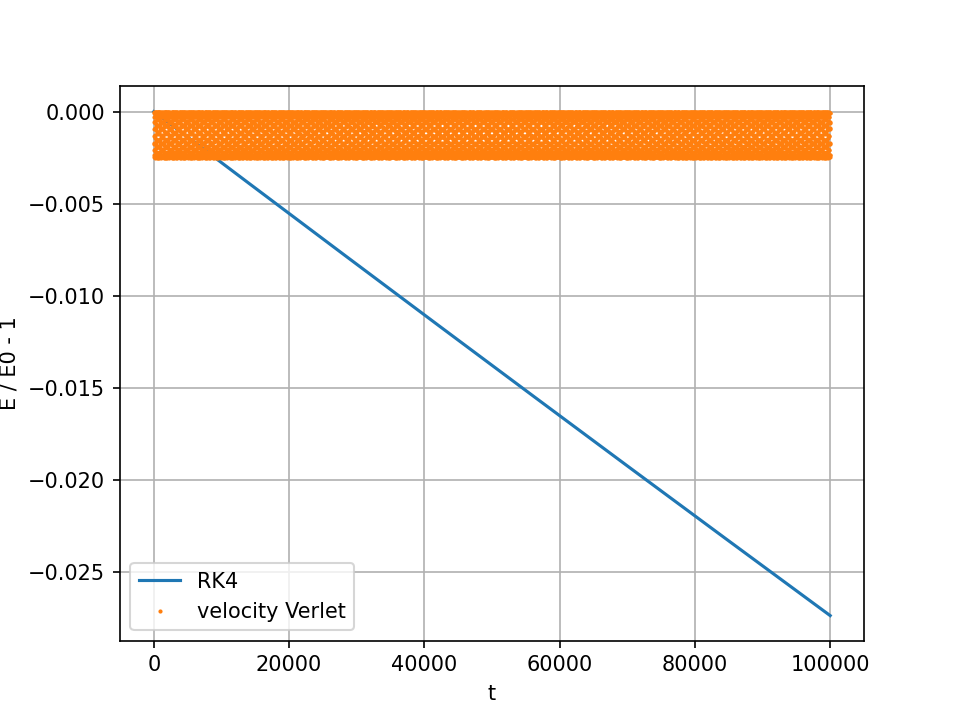
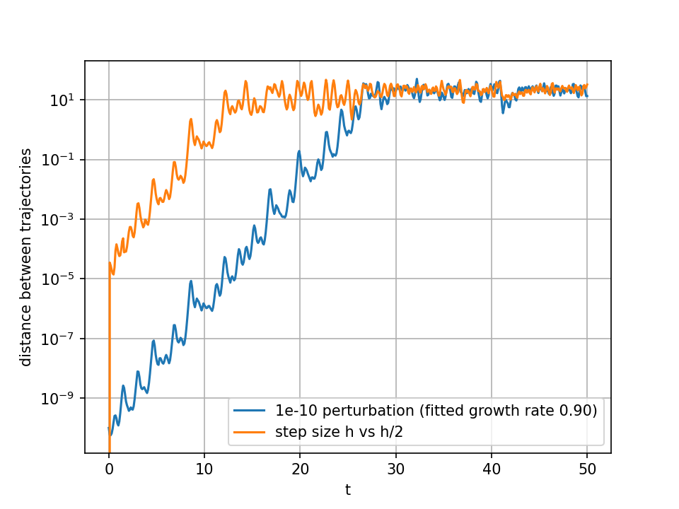
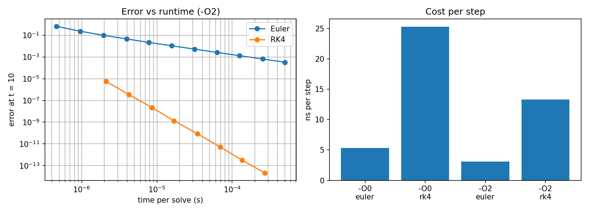

# Numerical Integrators in C

Forward Euler, classic Runge-Kutta 4, and velocity Verlet implemented in C and compared on accuracy, long-run energy behavior, chaotic divergence, and runtime. Every claim below comes from a measurement in this repo, and the Limitations section lists what I did not check.

## Setup

- C99, gcc `-O2 -Wall -Wextra` (the timing study also builds with `-O0`), Ubuntu on WSL, [CPU model]
- Plots made in Python (numpy, matplotlib) from CSV files the C programs write
- Convergence and timing system: damped oscillator x'' = -4x - 0.4x', x(0) = 1, v(0) = 0, which has an exact solution
- Error is the Euclidean distance in (x, v) from the exact solution at t = 10
- Step sizes h = 10/n with n = 10 * 2^i for i = 0..14, so h runs from 1.0 to 6.1e-5

## 1. Convergence (Euler vs RK4)

| h | Euler error | ratio | RK4 error | ratio |
|---|---|---|---|---|
| 1.000000 | 2.9921e+03 | - | 2.5364e-01 | - |
| 0.500000 | 6.4450e+02 | 4.64 | 3.9972e-02 | 6.35 |
| 0.250000 | 2.0792e+01 | 31.00 | 1.7823e-03 | 22.43 |
| 0.125000 | 2.8621e+00 | 7.26 | 9.4778e-05 | 18.80 |
| 0.062500 | 6.5905e-01 | 4.34 | 5.6237e-06 | 16.85 |
| 0.031250 | 2.2981e-01 | 2.87 | 3.4618e-07 | 16.25 |
| 0.015625 | 9.6998e-02 | 2.37 | 2.1537e-08 | 16.07 |
| 0.007812 | 4.4692e-02 | 2.17 | 1.3440e-09 | 16.02 |
| 0.003906 | 2.1467e-02 | 2.08 | 8.3948e-11 | 16.01 |
| 0.001953 | 1.0522e-02 | 2.04 | 5.2449e-12 | 16.01 |
| 0.000977 | 5.2094e-03 | 2.02 | 3.2837e-13 | 15.97 |
| 0.000488 | 2.5919e-03 | 2.01 | 2.1031e-14 | 15.61 |
| 0.000244 | 1.2927e-03 | 2.00 | 1.2831e-15 | 16.39 |
| 0.000122 | 6.4558e-04 | 2.00 | 1.1897e-15 | 1.08 |
| 0.000061 | 3.2259e-04 | 2.00 | 3.5997e-15 | 0.33 |



- Each row halves h. Euler's error ratio settles at 2.00 (first order) and RK4's at 16 (fourth order, since 2^4 = 16).
- Fitted log-log slopes: Euler 1.014 (window h < 0.01), RK4 4.018 (window h < 0.2 and error > 1e-11). Both windows were chosen by hand, and RK4's starts where the ratio is still 18.8, which is why its slope is slightly above 4.
- The coarse Euler rows (h = 1 down to 0.125) are unstable and not on any slope. For this system the Euler amplification factor has magnitude squared 1 - 0.4h + 4h^2, which is below 1 only for h < 0.1.
- RK4 hits a rounding floor near 1.2e-15 at h = 2.4e-4. Finer steps do not help and the error rises slightly (3.6e-15 at the finest step), because more steps accumulate more roundoff.

## 2. Energy drift (undamped oscillator)

x'' = -4x, h = 0.05, energy E = v^2/2 + 2x^2 normalized by its initial value.

| method | E/E0 at t = 500 (10,000 steps) | max abs(E/E0 - 1) |
|---|---|---|
| forward Euler | 1.6358e43 | - |
| RK4 | 0.9998612943 | 1.3871e-4 |
| velocity Verlet | 0.9975802383 | 2.5000e-3 |



- Euler multiplies the energy by exactly 1 + h^2 K = 1.01 each step, and 1.01^10000 is about 1.6358e43, matching the measurement.
- RK4 only loses energy, about 1.387e-8 per step, consistent with its stability polynomial at this step size.
- Verlet's worst-case error equals K h^2 / 4 = 2.5e-3 and does not trend.
- At t = 500 RK4 is more accurate than Verlet, so I ran a much longer test.

Long run to t = 100,000 (2,000,000 steps), RK4 and Verlet only:

| method | final E/E0 | max abs(E/E0 - 1) |
|---|---|---|
| RK4 | 0.972638 | 2.7362e-2 |
| velocity Verlet | 0.997527 | 2.5000e-3 |



RK4's energy error first exceeded Verlet's bound (0.0025) at t = 9022.6. Verlet stayed inside the same band for the entire run. This crossover is for this oscillator at h = 0.05 and is not a general rule.

## 3. Chaos (Lorenz system, RK4)

sigma = 10, rho = 28, beta = 8/3, h = 0.01, starting from (1, 1, 1) after a 20-time-unit burn-in (2000 RK4 steps) to land on the attractor.

| comparison | separation first exceeds 1.0 at |
|---|---|
| initial x perturbed by 1e-10 | t = 24.08 |
| step size h vs two steps of h/2 | t = 8.42 |

Fitted growth rate of the perturbation: 0.901 (separations from 1e-8 to 1.0).



- The h vs h/2 result means that at h = 0.01 the RK4 trajectory is only trustworthy until about t = 8 (the 1.0 threshold is arbitrary).
- Without the burn-in the same runs gave 35.15, 18.37, and a rate of 0.881. The first 3.8 time units showed no net growth: the perturbation grew to 1.9e-9 by t = 0.3, shrank back to about 1e-10 by t = 0.7, and stayed between 0.9e-10 and 1.6e-10 through t = 3.8. This is likely because (1, 1, 1) is near the origin, a saddle point, but I did not verify that.
- The 0.901 rate is a fit from one window, not a computed Lyapunov exponent.

## 4. Cost vs accuracy

Runtime per solve (fastest of 5 trials, repeated solves per trial) on the damped oscillator. Median cost per step, over runs with at least 1000 steps:

| build | Euler (ns/step) | RK4 (ns/step) | RK4 / Euler |
|---|---|---|---|
| -O0 | 5.3 | 25.3 | 4.8x |
| -O2 | 3.1 | 13.3 | 4.3x |

-O2 was 1.7x faster than -O0 for Euler and 1.9x for RK4, likely because -O0 keeps values in memory and does not inline `deriv`. I did not inspect the assembly.



Error versus runtime at -O2 has log-log slopes of about -1.0 for Euler and -4.0 for RK4, estimated by hand from selected CSV points:

- RK4 at 80 steps reaches error 9.5e-5 in 1.04 us. Euler's best row (163,840 steps) reaches 3.2e-4 in 502 us. That is about 480x less time and 3.4x smaller error.
- At matching error, Euler needs 125 us for 1.29e-3. RK4 gives 1.78e-3 at 0.51 us and 9.5e-5 at 1.04 us, so the equal-error speedup is between about 120x and 246x.

## Limitations

- Convergence and timing use one linear damped oscillator. The energy study uses one undamped oscillator at h = 0.05, so the crossover time is specific to that.
- Lorenz uses a single initial condition and a single perturbation (size 1e-10, in x), with an arbitrary 1.0 threshold.
- Timings were taken on one machine under WSL, which is noisier than native Linux. Per-step cost at very small step counts is lower than at large counts for both methods (for example Euler is about 1.0 ns/step at 10 steps and 3.06 at 163,840), and I did not investigate why.
- Explanations marked "likely" were not tested.
- Error combines position and velocity into one distance.

## Mistakes I fixed along the way

- My first Euler slope fit included points that had not converged (window h < 0.05, slope 1.04), so I narrowed it to h < 0.01 (slope 1.014).
- Comparing energy at t = 500 alone made RK4 look better than Verlet, so I added the long run.
- My first Lorenz run started at (1, 1, 1) with no burn-in, which delayed the divergence, so I added the burn-in.

## How to run

Requires gcc, make, python3, numpy, matplotlib.

```
make          # build everything
make run      # run all programs, writes the CSV files
make plots    # run, then regenerate all figures
make clean    # remove programs and CSVs
```

## Next steps

- Adaptive step size with an embedded method (RK45)
- A two-body orbit to show energy and angular momentum drift
- Reuse the integrators in a particle-based fluid simulation